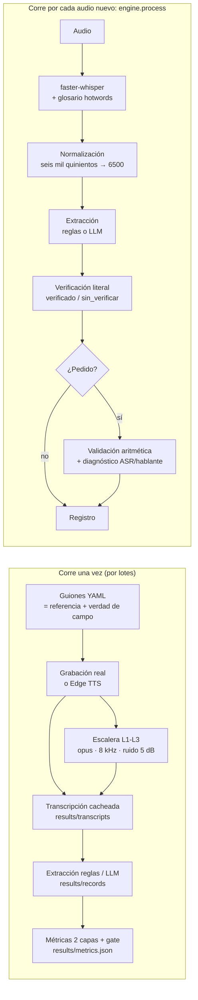

# De la voz al registro — HW05 Data Science

Convierte una **entrevista de trabajo** (Tarea 1) y una **llamada de pedido a una pollería** (Tarea 2) en un
**registro estructurado** que dice qué campos se **verificaron literalmente** en el audio y, en los pedidos,
si **la aritmética cuadra** (y, si no cuadra, si el error fue del ASR o de quien habló).

> **Corpus.** Las tablas principales salen de **8 grabaciones reales** con celular (4 entrevistas y 4 llamadas,
> 4 participantes distintos más el autor, que está en todos los clips). Aparte, como grupo **sintético
> separado** y nunca mezclado, están los 10 guiones leídos por voces Edge TTS (`tts-es-PE` y 4 acentos más),
> que sirvieron para construir el pipeline y para el eje de acentos.

- **Video:** _pendiente (enlace)_
- **Documento del pipeline (visual):** https://claude.ai/artifact/AwFa6AqcAgnbTutXqthZJ8 — qué corre una vez,
  qué corre por cada audio, y la decisión y el descarte de cada paso. Respaldo en Mermaid más abajo.
- **App pública:** _pendiente (Streamlit Community Cloud)_
- **Resultados completos:** [`results/summary.md`](results/summary.md) · datos crudos en [`results/metrics.json`](results/metrics.json)

## Declaraciones

- **Todo lo dicho en los audios es inventado.** Nombres de empresas, salarios, direcciones, montos y
  personas no corresponden a nadie real. Ningún dato personal real aparece en el corpus.
- **Consentimiento:** las 4 personas que grabaron con el autor (P1–P4) aceptaron participar y que su voz se
  use en este trabajo. No se nombra a ninguna.
- Dominio elegido para la Tarea 2: **restaurante** (pollería inventada "La Brasa Real").

## Estructura (pocos archivos, una responsabilidad cada uno)

| Archivo | Qué hace |
|---|---|
| [`engine.py`](engine.py) | **El motor único.** `process(audio, tarea)` → transcripción, campos, verificación, validación, dispositivo, tiempo y error. No importa ninguna librería de interfaz. |
| [`extraction.py`](extraction.py) | Normalización (números en palabras → dígitos), extracción por **reglas** y por **LLM**, verificación literal. |
| [`validation.py`](validation.py) | Validación aritmética del pedido y diagnóstico ASR vs. hablante. |
| [`metrics.py`](metrics.py) | WER/CER, exactitud por campo, F1 macro, error absoluto, IC bootstrap. |
| [`pipeline.py`](pipeline.py) | Pasos por lotes: TTS, escalera, transcripción cacheada, benchmark, extracción, evaluación y gate. |
| [`app.py`](app.py) | App Streamlit (5 pestañas). Solo lee resultados cacheados; el probador llama a `engine.process`. |
| [`mcp_server.py`](mcp_server.py) | Servidor MCP propio: expone el motor como herramienta para Claude Code. |
| [`config.yaml`](config.yaml) | **Toda** ruta, modelo, umbral, prompt, glosario, carta y esquema. |
| [`data/entrevistas.yaml`](data/entrevistas.yaml), [`data/llamadas.yaml`](data/llamadas.yaml) | Guiones = transcripción de referencia + verdad de campo + trampas. |
| [`colab_gpu.ipynb`](colab_gpu.ipynb) | Corre el benchmark en la GPU T4 gratuita de Colab con el mismo código. |
| [`.github/workflows/gate.yml`](.github/workflows/gate.yml) | Gate de regresión en GitHub Actions (sin GPU, desde transcripciones cacheadas). |

## Pipeline



## Reproducir

Requisitos: Python 3.12 (`uv` recomendado). Opcional: [Ollama](https://ollama.com) para la ruta LLM.

```bash
uv venv --python 3.12 .venv
uv pip install --python .venv -r requirements.txt
ollama pull qwen2.5:3b
```

Comandos (ver `python pipeline.py -h`):

```bash
python pipeline.py tts --locales es-PE es-MX es-ES es-AR es-CO
python pipeline.py ladder --corpus tts-es-PE
python pipeline.py transcribe --corpus tts-es-PE
python pipeline.py transcribe --corpus tts-es-PE --task pedido --level L1 L2 L3
python pipeline.py extract --extractor rules
python pipeline.py extract --extractor llm --runs "tts-es-PE__*__small__*__glosario"
python pipeline.py evaluate
streamlit run app.py
```

La comparación en GPU se corre en Colab con [`colab_gpu.ipynb`](colab_gpu.ipynb) (`pipeline.py bench`);
el zip que descarga se copia a `results/transcripts/` y se vuelve a correr `evaluate`.

**El motor no importa librerías de interfaz.** Comando de verificación (también corre en CI):

```bash
python -c "import engine, sys; assert 'streamlit' not in sys.modules"
```

### Corpus real
- Cada participante (P1–P4) grabó con el autor una entrevista y una llamada leyendo el guion, con celular.
  Los audios van en `data/audio/real/<id>.m4a`; E05 y L05 no se grabaron y existen solo como sintéticos.
- Lo que se dijo distinto al guion está en el bloque `grabacion` de cada clip (`reemplazos` de texto y
  `campos`), **verificado escuchando el audio**, no copiado del ASR: usar la salida de Whisper como referencia
  mediría a Whisper contra sí mismo. `pipeline.ground_truth(tarea, "real")` aplica esos cambios solo al
  corpus real, porque las voces sintéticas sí leyeron el guion original.
- Comandos: los de arriba con `--corpus real` (es el `main_corpus` de `config.yaml`).

### GPU en Colab
Abre [`colab_gpu.ipynb`](colab_gpu.ipynb) en Colab con una T4, sube los audios a `MyDrive/HW05_audio/` y corre
todas las celdas. `pipeline.py bench` transcribe con `small` y `large-v3` en `float16` e `int8`, con y sin
glosario, y `small` en CPU sobre los mismos clips. Descarga el zip, cópialo a `results/transcripts/` y corre
`python pipeline.py extract && python pipeline.py evaluate`.

### Diarización (opcional)
```bash
uv pip install --python .venv -r requirements-diarization.txt
```
Crea un token de lectura en Hugging Face, acepta los términos de `pyannote/speaker-diarization-community-1`,
y pon `HF_TOKEN=...` en `.env` (`diarization.enabled: true` ya está en `config.yaml`; sin token se omite, como
en la app pública). Desde entonces cada pedido que pasa por `engine.process` trae `validation.correcciones`
con el hablante y el rol (cliente o vendedor). Probado en L01: separó vendedor y cliente y atribuyó al cliente
"cámbieme el medio pollo por un pollo entero" (≈3 min en CPU para 100 s de audio, incluida la descarga).

### Despliegue público (Streamlit Community Cloud)
En share.streamlit.io: *Create app* → repositorio `luyov-belli/HW05_DS`, rama `main`, archivo `app.py`,
*Advanced settings* → Python 3.12. La app solo lee `results/`, así que no necesita GPU ni Ollama; el
probador usa el modelo `base` y la ruta de reglas (la ruta LLM requiere Ollama local).

**Audios y pesos de modelos no se suben.** Los clips sintéticos se regeneran con `pipeline.py tts`; la
escalera con `pipeline.py ladder`; los pesos de Whisper se descargan solos la primera vez. Las grabaciones
reales se pueden solicitar al autor (contienen voces de personas que aceptaron solo este uso).
Las **transcripciones cacheadas** sí están en `results/transcripts/`.

## Decisiones técnicas

### Corpus y verdad de campo
- **El guion es la verdad de campo.** Cada clip de `data/*.yaml` tiene el guion (transcripción de referencia,
  líneas `A:`/`B:`), los valores correctos de cada campo y, en las llamadas, las trampas. Escribirlo antes de
  grabar hace que la verdad de campo no cueste nada; si al grabar alguien se desvía, se corrige el guion.
- **Variación de posición y forma** (campo `variacion` de cada entrevista): el salario aparece al inicio, al
  medio o al final; los años se dicen como total, como suma (3 + 2,5) o contando prácticas; el inglés como
  nivel, como certificación (C1, B2) o con matices ("intermedio alto"); hay tecnologías negadas (AWS, Azure,
  Snowflake) y números distractores (sueldo anterior, billete de 200, "unos cuarenta minutos").
- **Trampas de las llamadas grabadas:** 3 correcciones del cliente (L01, L02, L04) y 3 totales mal dichos a
  propósito (L02, L03, L04); todas las direcciones llevan dígitos. Detalle en el campo `nota` de cada llamada.
  L01 es además el control: su total sí cuadra.

### Normalización (una sola regla para todo)
`extraction.normalize`: minúsculas; sin tildes; sin etiquetas `A:`/`B:`; `S/`→soles, `$`→dolares,
`%`→porciento; separador de miles fuera (`6.500`, `6,500` → `6500`) y coma decimal a punto; sin
puntuación; **números en palabras a dígitos** (`seis mil quinientos` → `6500`, `ciento veintisiete` → `127`,
`tres mil veintiuno` → `3021`); `N con NN` → decimal (`sesenta y dos con cincuenta` → `62.50`) y
`N años y medio` → `N.5`. El parser solo une palabras de mayor a menor posición (centenas → decenas →
unidades), así `veinticuatro cincuenta` queda como `24 50` y no como 74. Se aplica igual a referencia e
hipótesis antes del WER, y a transcripción y valores antes de verificar. Efectos conocidos: `un/una/uno` → `1`
(el WER no ve una confusión *un*/*una*) y `años` → `anos` en ambos lados.

### Glosario: `hotwords`, no `initial_prompt`
La documentación pública es inconsistente; se resolvió leyendo el código de **faster-whisper 1.2.1**
(`WhisperModel.get_prompt` en `faster_whisper/transcribe.py`): `hotwords` se inserta en el prompt de
**cada** ventana de 30 s (si no hay `prefix`), mientras que `initial_prompt` entra una sola vez a la lista
de tokens previos y, como el contexto se recorta a los últimos 223 tokens, desaparece después del primer
minuto de un audio de 2–4 minutos. Por eso el glosario de `config.yaml` se pasa como `hotwords`.

### GPU: evidencia medida, no configurada
Cada corrida guarda `device_runtime` y `compute_type_runtime` **leídos del modelo CTranslate2 ya cargado**
(`WhisperModel.model.device`), y `vram_peak_mb`, el pico de memoria de la GPU medido con NVML en un hilo que
muestrea cada 50 ms, menos la línea base previa a cargar el modelo. En CPU, `vram_peak_mb` queda vacío y el
dispositivo dice `cpu` aunque el config diga `auto`.

### Dos rutas de extracción y la regla de verificación
- **Reglas** (`extract_rules`): número más cercano a una palabra clave (con unidad: "años", moneda);
  vocabularios cerrados para tecnologías, categorías y la carta; en el pedido cada mención de un producto
  actualiza su línea (la última gana, así las correcciones quedan), y "quíteme/sin/no" antes del producto lo
  elimina.
- **LLM local** (`extract_llm`): `qwen2.5:3b` en Ollama con salida JSON; las respuestas se llevan a los nombres
  canónicos de `config.yaml` sin tocar los números. Local a propósito: el contenido de las llamadas no sale de
  la máquina, que es justo lo que las alternativas comerciales no ofrecen.
- **Verificación literal** (`verify`): cada valor debe aparecer en la transcripción normalizada; si no, el
  campo queda `sin_verificar`. Ejemplo: en E02 el total de años (5,5) nunca se dice; un LLM que suma "tres
  años" y "dos años y medio" acierta, pero el campo queda `sin_verificar`, porque la próxima vez el modelo
  "corregirá" y se equivocará.

### Validación aritmética y diagnóstico (Tarea 2)
`check_order`: Σ cantidad × precio − promoción vs. `total_dicho` (tolerancia en `config.yaml`). Si no cuadra,
`diagnose` decide la causa: **error de ASR** si algún precio no coincide con la carta o si Whisper dio
probabilidad < 0,6 a una palabra numérica en un segmento donde se oye un número del pedido; si no hay esas
señales, **error de quien habló**. Nunca se reemplaza el total dicho por el calculado.

### Escalera de degradación
| Nivel | Simula | Transformación |
|---|---|---|
| L0 | Como se grabó | Sin cambios |
| L1 | Nota de voz de WhatsApp | Opus 12 kbps, mono, 16 kHz (codificar y decodificar con PyAV) |
| L2 | Llamada telefónica | Butterworth pasa banda 300–3400 Hz (orden 6) y remuestreo a 8 kHz |
| L3 | Lugar ruidoso | Murmullo a **5 dB SNR** y luego la compresión de L1 |

**Por qué 5 dB:** es el rango de un restaurante o una calle concurrida (≈0–10 dB); a 15–20 dB Whisper
apenas se inmuta y el nivel no degradaría nada. **Cómo se mide:** potencia de la voz como la media de energía
en tramas de 25 ms que están a menos de 40 dB del pico (excluye silencios), potencia del ruido sobre toda la
mezcla de ruido; el ruido se escala a la razón exacta y el SNR resultante se registra por clip en
`results/ladder_<corpus>.json`. El ruido es **murmullo real**: cuatro conversaciones ajenas del mismo corpus
superpuestas con desfases aleatorios (semilla fija), no ruido blanco.

### Un motor, dos esquemas
`engine.process(audio, "entrevista")` y `engine.process(audio, "pedido")` ejecutan exactamente el mismo
código. Lo que cambia es `config.yaml → schemas`: cada campo declara su **tipo** (`number`, `money`, `text`,
`list`, `category`, `items`) y `extraction.py` sabe extraer, verificar y comparar tipos, no campos. Agregar un
tercer registro (p. ej. una llamada de telefonía) es escribir un esquema, no copiar el motor. Si se cambia
de modelo Whisper o de LLM, se cambia una línea del config y lo heredan la app, el pipeline y el MCP.

## Resultados — corpus real (4 entrevistas + 4 llamadas)

Tablas completas, con IC95 bootstrap y todas las corridas (también las sintéticas), en
[`results/summary.md`](results/summary.md). Configuración de referencia: `small`, CPU `int8`, glosario como
`hotwords`, VAD 0.25. Con 4 clips por tarea, los IC son anchos: leer las diferencias como tendencias.

### Capa 1 — Transcripción

| Corrida (entrevistas) | WER | IC95 | CER |
|---|---:|---|---:|
| `base` int8 | 15.0 % | [11.2, 19.3] | 6.7 % |
| `small` int8 (referencia) | **6.9 %** | [4.0, 8.9] | 3.1 % |
| `small` float32 | 6.6 % | [3.7, 8.9] | 2.7 % |
| `small` int8 sin glosario | 8.1 % | [5.4, 10.2] | 3.5 % |

Llamadas (referencia): WER **9.1 %** [5.6, 12.6], CER 4.1 %. La voz real tiene **10 a 15 veces más errores**
que la sintética (0.6 % en ambas tareas): justo lo que el enunciado advertía del audio sintético.

- **Dos tamaños:** `base` duplica el WER de `small` (15.0 % vs 6.9 %). La velocidad se midió en una laptop
  con otras tareas en paralelo, así que solo vale como orden de magnitud: `base` ≈ 7 s por minuto de audio,
  `small` ≈ 15 s en la corrida más limpia.
- **Dos precisiones (CPU):** `float32` e `int8` dan WER casi igual, pero **ninguna de las 4 transcripciones
  sale idéntica** (1,9 % de palabras distintas entre ambas). Cambiar la precisión cambia el texto, no solo la
  velocidad.
- **Glosario (`hotwords`)**, mejora pareada por clip: entrevistas −1,07 pp de WER, IC95 [0,1, 1,7]; llamadas
  −2,03 pp, IC95 [−0,3, 6,1] (**incluye el cero**: con 4 llamadas no se puede afirmar que mejore). El *recall*
  de términos del glosario sube de 95 % a 100 % en entrevistas y de 53 % a 88 % en llamadas.
- **GPU:** pendiente de la corrida en Colab (`colab_gpu.ipynb`); se agrega con `device_runtime = cuda` y
  `vram_peak_mb` medido. Las corridas de CPU ya muestran la evidencia negativa: `device_runtime = cpu`, sin VRAM.

### Capa 2 — Registro (L0)

| Tarea | Extractor | Exactitud | IC95 | Lo que más falla |
|---|---|---:|---|---|
| Entrevista | reglas | 0.75 | [0.58, 0.92] | `tecnologias` 0.25, `anios_experiencia` 0.50 |
| Entrevista | LLM | **0.88** | [0.75, 1.00] | E04: años, tecnologías e inglés |
| Pedido | reglas | **0.90** | [0.75, 1.00] | `direccion_entrega` 0.50 ("Surco" → "surgo") |
| Pedido | LLM | 0.80 | [0.60, 0.95] | `items` 0.50, `direccion_entrega` 0.50 |

F1 macro: `disponibilidad` 1.0 en ambos; `nivel_ingles` 1.0 reglas y 0.78 LLM; `metodo_pago` y `promocion` 1.0.
Error absoluto medio: `anios_experiencia` 1.0 años con reglas y 0.12 con LLM; salario y total, 0.

Con voz real el LLM supera a las reglas en entrevistas (donde la respuesta se dice de formas variadas) y
las reglas siguen ganando en pedidos (vocabulario cerrado y una carta conocida).

**La verificación literal funciona como alarma:** con LLM, de los campos marcados `verificado` 20 de 21 son
correctos; de los `sin_verificar`, solo 1 de 3. El correcto es E02: 5,5 años obtenidos **sumando** "tres años"
y "dos años y medio"; acierta, pero nadie lo dijo, así que queda `sin_verificar`. Los otros dos (E04: 2,5 años
e inglés "intermedio") son errores reales del LLM, y la verificación los marcó.

**¿El WER predice si el registro sirve? No.** La llamada L01 en L2 (teléfono) tiene **WER 16,4 %** y su
registro es **perfecto**; la entrevista E02 tiene **WER 2,9 %** y su registro está **roto** (años y
tecnologías mal). El error que importa es el que cae en un campo: un campo categórico tolera mucho ruido y un
monto no tolera un dígito. Quien reporta solo WER no sabe si el dato sirve.

### Escalera de degradación y validador aritmético (llamadas reales)

| Nivel | WER | Exactitud registro (reglas / LLM) | Atrapados | Escapados | Falsas alarmas | Diagnóstico correcto (reglas) |
|---|---:|---|---:|---:|---:|---|
| L0 tal cual | 9.1 % | 0.90 / 0.80 | 3 | 0 | 0 | 3/3 |
| L1 WhatsApp | 11.5 % | 0.85 / 0.80 | 3 | 0 | 0 | 3/3 |
| L2 teléfono | 11.3 % | 0.85 / 0.70 | 3 | 0 | 0 | 3/3 |
| L3 ruido 5 dB | **56.9 %** | **0.50** / 0.50 | 4 | 0 | 0 | 0/0 (casos ambiguos) |

- El validador atrapa los 3 totales mal dichos en todos los niveles, sin falsas alarmas en L01, que cuadra.
  En L3 atrapa además L01, cuyo registro rompió el ruido. Con 3–4 casos por nivel esto es un **conteo**, no
  una tasa de detección.
- El diagnóstico atribuye bien al hablante los 3 errores sembrados en L0–L2. En L3 ningún pedido sembrado
  quedó con el resto del registro intacto, así que no hay casos evaluables.
- **L3 sí degrada** (el registro cae a 0.50 y el WER a 57 %), así que la escalera no necesitó endurecerse.
- **Hallazgo del VAD:** con el umbral por defecto de Silero (0.5), el VAD borra tramos de voz de banda
  telefónica antes de que lleguen a Whisper. En las llamadas reales en L2, bajar el umbral a 0.25 baja el WER
  de 13,9 % a 11,3 % (mejora pareada 2,5 pp, IC95 [1,1, 4,1]); con voz sintética el efecto fue enorme
  (61 % → 1,3 %), porque la voz TTS es más uniforme y el VAD la descartaba entera.

### Grupo sintético (separado): voces Edge TTS, 5 + 5 clips

| Voz | WER entrevistas | WER pedidos |
|---|---:|---:|
| es-PE | 0.56 % | 0.60 % |
| es-MX | 0.56 % | 0.72 % |
| es-AR | 1.37 % | 1.08 % |
| es-ES | 3.71 % | 1.20 % |
| es-CO | 6.94 % | 4.70 % |

**Eje de acentos:** describe cómo `small` trata esas **voces sintéticas**, no a hablantes reales de esos
países. Con `tts-es-PE` el registro llega a 0.80 (entrevistas) y 0.96 (pedidos) con reglas; la escalera
sintética, el efecto del glosario y del VAD están en `results/summary.md`.

## Limitaciones y lo que la muestra no soporta

- **Cuatro clips reales por tarea.** 4 entrevistas × 6 campos = 24 observaciones: un campo que pasa de 2/4 a
  3/4 cambia su exactitud en 25 puntos. Los IC bootstrap son anchos y se reportan siempre; ninguna diferencia
  con IC solapados (por ejemplo LLM vs. reglas) debe leerse como un resultado firme.
- **Duración por debajo de lo pedido.** E03 y E04 duran 1:42 y 1:44, y las cuatro llamadas entre 1:19 y
  1:37, menos que los 2 minutos mínimos del enunciado: se leyó el guion a ritmo natural, sin conversación
  extra. Hay menos palabras por clip y, por eso, IC más anchos.
- **El corpus sintético es demasiado limpio** (WER < 1 %) y tiene sus propios errores sistemáticos (la voz
  peruana dice "Python" y Whisper escribe "paisan"). Por eso no se mezcla con el real.
- **Los guiones están escritos por el mismo autor que las reglas.** Las reglas pueden estar sobreajustadas a
  la forma de hablar de los guiones; el LLM no lo está. Los desvíos espontáneos de las grabaciones reales
  (muletillas, género gramatical) son una prueba más justa, pero siguen siendo lecturas de guion.
- **El LLM es pequeño** (`qwen2.5:3b` en CPU, ~35 s por clip). Un modelo mayor rendiría más; se priorizó que
  el contenido no salga de la máquina.
- **La regla de diagnóstico** solo ve lo que Whisper reporta: si Whisper oye mal un número **con alta
  confianza** y el precio coincide con otra entrada de la carta, el error se atribuye al hablante.
- **Escalera:** el murmullo se arma con otras conversaciones del mismo corpus (las mismas voces del estudio);
  en la calle real el ruido es más variado (tráfico, música, platos).

### Lo que este sistema nunca debe hacer
- **Decidir sobre personas.** El registro de entrevista resume lo que se dijo; no evalúa ni filtra candidatos.
  Una pretensión salarial `sin_verificar` no es un dato, es una pregunta para un humano.
- **Cobrar o despachar sin revisión** un pedido que no cuadra o que tiene campos `sin_verificar`.
- **Procesar voces sin consentimiento** ni enviar audios de clientes a servicios externos.

## Innovación

| Innovación | Dónde | Qué aporta |
|---|---|---|
| **Gate de regresión en GitHub Actions** | `.github/workflows/gate.yml` | Re-extrae con reglas y recalcula métricas **desde transcripciones cacheadas** (los runners no tienen GPU; transcribir ahí sería 40× más lento o imposible). Falla si el WER o la exactitud bajan de los umbrales de `config.yaml`. |
| **Servidor MCP propio** | `mcp_server.py`, `.mcp.json` | Herramientas `procesar_audio` y `extraer_de_texto`: un agente en Claude Code transcribe y extrae con **la misma función** del motor. |
| **Eje de acentos** | `pipeline.py tts --locales ...` | El mismo guion con voces sintéticas de PE, MX, ES, AR y CO. **Son voces sintéticas, no hablantes humanos**: el resultado describe cómo el modelo trata esas voces, no acentos reales. |
| **Separación de hablantes** | `engine.diarize`, `requirements-diarization.txt` | pyannote (`HF_TOKEN` + aceptar términos). Atribuye cada corrección del pedido a **cliente** o **vendedor**. Se activa sola cuando hay `HF_TOKEN`. |
| **Despliegue público** | Streamlit Community Cloud | La app lee resultados cacheados, así que corre sin GPU ni Ollama (el probador usa el modelo `base` y la ruta de reglas). |

## Herramientas de IA declaradas

- **Claude Code (Claude)**: diseño del pipeline, escritura del código, guiones y documentación, revisado y
  ejecutado en esta PC.
- **Servidores MCP conectados en Claude Code**: `voz-a-registro` (el propio, `mcp_server.py`) para probar el
  motor desde el agente. _Agrega aquí cualquier otro servidor MCP que hayas conectado (p. ej. Notion o Miro
  si lo usaste para el documento del pipeline)._
