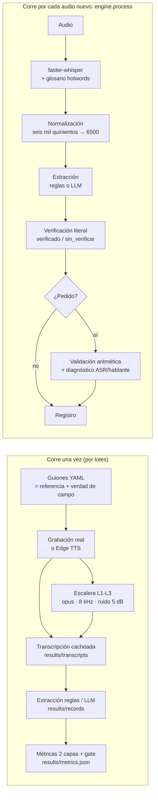

# De la voz al registro — HW05 Data Science

Convierte una **entrevista de trabajo** (Tarea 1) y una **llamada de pedido a una pollería** (Tarea 2) en un
**registro estructurado** que dice qué campos se **verificaron literalmente** en el audio y, en los pedidos,
si **la aritmética cuadra** (y, si no cuadra, si el error fue del ASR o de quien habló).

> **Estado del corpus.** Las tablas de este README salen hoy del corpus **sintético** `tts-es-PE`
> (Edge TTS, voces peruanas), que sirvió para construir y probar el pipeline de punta a punta. Las
> grabaciones reales se agregan en `data/audio/real/` y basta cambiar `evaluation.main_corpus: real`
> en `config.yaml` y volver a correr el pipeline (sección [Reproducir](#reproducir)). El grupo sintético
> se reporta siempre **separado** y nunca se mezcla con el real.

- **Video:** _pendiente (enlace)_
- **Documento del pipeline (visual):** https://claude.ai/artifact/AwFa6AqcAgnbTutXqthZJ8 — qué corre una vez,
  qué corre por cada audio, y la decisión y el descarte de cada paso. Respaldo en Mermaid más abajo.
- **App pública:** _pendiente (Streamlit Community Cloud)_
- **Resultados completos:** [`results/summary.md`](results/summary.md) · datos crudos en [`results/metrics.json`](results/metrics.json)

## Declaraciones

- **Todo lo dicho en los audios es inventado.** Nombres de empresas, salarios, direcciones, montos y
  personas no corresponden a nadie real. Ningún dato personal real aparece en el corpus.
- **Consentimiento:** todas las personas que aparecen en las grabaciones aceptaron participar y que su voz
  se use en este trabajo. No se nombra a nadie que no haya aceptado ser nombrado.
- Dominio elegido para la Tarea 2: **restaurante** (pollería inventada "La Brasa Real").

## Estructura (pocos archivos, una responsabilidad cada uno)

| Archivo | Qué hace |
|---|---|
| [`engine.py`](engine.py) | **El motor único.** `process(audio, tarea)` → transcripción, campos, verificación, validación, dispositivo, tiempo y error. No importa ninguna librería de interfaz. |
| [`extraction.py`](extraction.py) | Normalización (números en palabras → dígitos), extracción por **reglas** y por **LLM**, verificación literal. |
| [`validation.py`](validation.py) | Validación aritmética del pedido y diagnóstico ASR vs. hablante. |
| [`metrics.py`](metrics.py) | WER/CER, exactitud por campo, F1 macro, error absoluto, IC bootstrap. |
| [`pipeline.py`](pipeline.py) | Pasos por lotes: TTS, escalera, transcripción cacheada, benchmark, extracción, evaluación y gate. |
| [`app.py`](app.py) | App Streamlit (5 pestañas). Solo lee resultados cacheados; el probador llama a `engine.process`. |
| [`mcp_server.py`](mcp_server.py) | Servidor MCP propio: expone el motor como herramienta para Claude Code. |
| [`config.yaml`](config.yaml) | **Toda** ruta, modelo, umbral, prompt, glosario, carta y esquema. |
| [`data/entrevistas.yaml`](data/entrevistas.yaml), [`data/llamadas.yaml`](data/llamadas.yaml) | Guiones = transcripción de referencia + verdad de campo + trampas. |
| [`colab_gpu.ipynb`](colab_gpu.ipynb) | Corre el benchmark en la GPU T4 gratuita de Colab con el mismo código. |
| [`.github/workflows/gate.yml`](.github/workflows/gate.yml) | Gate de regresión en GitHub Actions (sin GPU, desde transcripciones cacheadas). |

## Pipeline



## Reproducir

Requisitos: Python 3.12 (`uv` recomendado). Opcional: [Ollama](https://ollama.com) para la ruta LLM.

```bash
uv venv --python 3.12 .venv
uv pip install --python .venv -r requirements.txt
ollama pull qwen2.5:3b
```

Comandos (ver `python pipeline.py -h`):

```bash
python pipeline.py tts --locales es-PE es-MX es-ES es-AR es-CO
python pipeline.py ladder --corpus tts-es-PE
python pipeline.py transcribe --corpus tts-es-PE
python pipeline.py transcribe --corpus tts-es-PE --task pedido --level L1 L2 L3
python pipeline.py extract --extractor rules
python pipeline.py extract --extractor llm --runs "tts-es-PE__*__small__*__glosario"
python pipeline.py evaluate
streamlit run app.py
```

La comparación en GPU se corre en Colab con [`colab_gpu.ipynb`](colab_gpu.ipynb) (`pipeline.py bench`);
el zip que descarga se copia a `results/transcripts/` y se vuelve a correr `evaluate`.

**El motor no importa librerías de interfaz.** Comando de verificación (también corre en CI):

```bash
python -c "import engine, sys; assert 'streamlit' not in sys.modules"
```

### Grabar el corpus real
1. Lee el guion de cada clip con tu compañero/a (tú siempre eres una de las dos voces), con el celular.
2. Guarda cada audio como `data/audio/real/<id>.<ext>` (`E01.m4a` … `L05.m4a`; cualquier formato que lea ffmpeg).
3. Si alguien se desvió del guion, corrige el texto en el YAML para que sea exactamente lo que se oye.
4. En `config.yaml` pon `evaluation.main_corpus: real` y corre `ladder`, `transcribe`, `extract` y `evaluate`
   con `--corpus real`.

### GPU en Colab
Abre [`colab_gpu.ipynb`](colab_gpu.ipynb) en Colab con una T4, sube los audios a `MyDrive/HW05_audio/` y corre
todas las celdas. `pipeline.py bench` transcribe con `small` y `large-v3` en `float16` e `int8`, con y sin
glosario, y `small` en CPU sobre los mismos clips. Descarga el zip, cópialo a `results/transcripts/` y corre
`python pipeline.py extract && python pipeline.py evaluate`.

### Diarización (opcional)
```bash
uv pip install --python .venv -r requirements-diarization.txt
```
Crea un token de lectura en Hugging Face, acepta los términos de `pyannote/speaker-diarization-community-1`,
y pon `HF_TOKEN=...` en `.env` (`diarization.enabled: true` ya está en `config.yaml`; sin token se omite, como
en la app pública). Desde entonces cada pedido que pasa por `engine.process` trae `validation.correcciones`
con el hablante y el rol (cliente o vendedor). Probado en L01: separó vendedor y cliente y atribuyó al cliente
"cámbieme el medio pollo por un pollo entero" (≈3 min en CPU para 100 s de audio, incluida la descarga).

### Despliegue público (Streamlit Community Cloud)
En share.streamlit.io: *Create app* → repositorio `luyov-belli/HW05_DS`, rama `main`, archivo `app.py`,
*Advanced settings* → Python 3.12. La app solo lee `results/`, así que no necesita GPU ni Ollama; el
probador usa el modelo `base` y la ruta de reglas (la ruta LLM requiere Ollama local).

**Audios y pesos de modelos no se suben.** Los clips sintéticos se regeneran con `pipeline.py tts`; la
escalera con `pipeline.py ladder`; los pesos de Whisper se descargan solos la primera vez. Las grabaciones
reales se pueden solicitar al autor (contienen voces de personas que aceptaron solo este uso).
Las **transcripciones cacheadas** sí están en `results/transcripts/`.

## Decisiones técnicas

### Corpus y verdad de campo
- **El guion es la verdad de campo.** Cada clip de `data/*.yaml` tiene el guion (transcripción de referencia,
  líneas `A:`/`B:`), los valores correctos de cada campo y, en las llamadas, las trampas. Escribirlo antes de
  grabar hace que la verdad de campo no cueste nada; si al grabar alguien se desvía, se corrige el guion.
- **Variación de posición y forma** (campo `variacion` de cada entrevista): el salario aparece al inicio, al
  medio o al final; los años se dicen como total, como suma (3 + 2,5) o contando prácticas; el inglés como
  nivel, como certificación (C1, B2) o con matices ("intermedio alto"); hay tecnologías negadas (AWS, Azure,
  Snowflake) y números distractores (sueldo anterior, billete de 200, "unos cuarenta minutos").
- **Trampas de las llamadas:** 4 correcciones del cliente (L01, L02, L04, L05) y 3 totales mal dichos a
  propósito (L02, L03, L04); todas las direcciones llevan dígitos. Detalle en el campo `nota` de cada llamada.

### Normalización (una sola regla para todo)
`extraction.normalize`: minúsculas; sin tildes; sin etiquetas `A:`/`B:`; `S/`→soles, `$`→dolares,
`%`→porciento; separador de miles fuera (`6.500`, `6,500` → `6500`) y coma decimal a punto; sin
puntuación; **números en palabras a dígitos** (`seis mil quinientos` → `6500`, `ciento veintisiete` → `127`,
`tres mil veintiuno` → `3021`); `N con NN` → decimal (`sesenta y dos con cincuenta` → `62.50`) y
`N años y medio` → `N.5`. El parser solo une palabras de mayor a menor posición (centenas → decenas →
unidades), así `veinticuatro cincuenta` queda como `24 50` y no como 74. Se aplica igual a referencia e
hipótesis antes del WER, y a transcripción y valores antes de verificar. Efectos conocidos: `un/una/uno` → `1`
(el WER no ve una confusión *un*/*una*) y `años` → `anos` en ambos lados.

### Glosario: `hotwords`, no `initial_prompt`
La documentación pública es inconsistente; se resolvió leyendo el código de **faster-whisper 1.2.1**
(`WhisperModel.get_prompt` en `faster_whisper/transcribe.py`): `hotwords` se inserta en el prompt de
**cada** ventana de 30 s (si no hay `prefix`), mientras que `initial_prompt` entra una sola vez a la lista
de tokens previos y, como el contexto se recorta a los últimos 223 tokens, desaparece después del primer
minuto de un audio de 2–4 minutos. Por eso el glosario de `config.yaml` se pasa como `hotwords`.

### GPU: evidencia medida, no configurada
Cada corrida guarda `device_runtime` y `compute_type_runtime` **leídos del modelo CTranslate2 ya cargado**
(`WhisperModel.model.device`), y `vram_peak_mb`, el pico de memoria de la GPU medido con NVML en un hilo que
muestrea cada 50 ms, menos la línea base previa a cargar el modelo. En CPU, `vram_peak_mb` queda vacío y el
dispositivo dice `cpu` aunque el config diga `auto`.

### Dos rutas de extracción y la regla de verificación
- **Reglas** (`extract_rules`): número más cercano a una palabra clave (con unidad: "años", moneda);
  vocabularios cerrados para tecnologías, categorías y la carta; en el pedido cada mención de un producto
  actualiza su línea (la última gana, así las correcciones quedan), y "quíteme/sin/no" antes del producto lo
  elimina.
- **LLM local** (`extract_llm`): `qwen2.5:3b` en Ollama con salida JSON; las respuestas se llevan a los nombres
  canónicos de `config.yaml` sin tocar los números. Local a propósito: el contenido de las llamadas no sale de
  la máquina, que es justo lo que las alternativas comerciales no ofrecen.
- **Verificación literal** (`verify`): cada valor debe aparecer en la transcripción normalizada; si no, el
  campo queda `sin_verificar`. Ejemplo: en E02 el total de años (5,5) nunca se dice; un LLM que suma "tres
  años" y "dos años y medio" acierta, pero el campo queda `sin_verificar`, porque la próxima vez el modelo
  "corregirá" y se equivocará.

### Validación aritmética y diagnóstico (Tarea 2)
`check_order`: Σ cantidad × precio − promoción vs. `total_dicho` (tolerancia en `config.yaml`). Si no cuadra,
`diagnose` decide la causa: **error de ASR** si algún precio no coincide con la carta o si Whisper dio
probabilidad < 0,6 a una palabra numérica en un segmento donde se oye un número del pedido; si no hay esas
señales, **error de quien habló**. Nunca se reemplaza el total dicho por el calculado.

### Escalera de degradación
| Nivel | Simula | Transformación |
|---|---|---|
| L0 | Como se grabó | Sin cambios |
| L1 | Nota de voz de WhatsApp | Opus 12 kbps, mono, 16 kHz (codificar y decodificar con PyAV) |
| L2 | Llamada telefónica | Butterworth pasa banda 300–3400 Hz (orden 6) y remuestreo a 8 kHz |
| L3 | Lugar ruidoso | Murmullo a **5 dB SNR** y luego la compresión de L1 |

**Por qué 5 dB:** es el rango de un restaurante o una calle concurrida (≈0–10 dB); a 15–20 dB Whisper
apenas se inmuta y el nivel no degradaría nada. **Cómo se mide:** potencia de la voz como la media de energía
en tramas de 25 ms que están a menos de 40 dB del pico (excluye silencios), potencia del ruido sobre toda la
mezcla de ruido; el ruido se escala a la razón exacta y el SNR resultante se registra por clip en
`results/ladder_<corpus>.json`. El ruido es **murmullo real**: cuatro conversaciones ajenas del mismo corpus
superpuestas con desfases aleatorios (semilla fija), no ruido blanco.

### Un motor, dos esquemas
`engine.process(audio, "entrevista")` y `engine.process(audio, "pedido")` ejecutan exactamente el mismo
código. Lo que cambia es `config.yaml → schemas`: cada campo declara su **tipo** (`number`, `money`, `text`,
`list`, `category`, `items`) y `extraction.py` sabe extraer, verificar y comparar tipos, no campos. Agregar un
tercer registro (p. ej. una llamada de telefonía) es escribir un esquema, no copiar el motor. Si se cambia
de modelo Whisper o de LLM, se cambia una línea del config y lo heredan la app, el pipeline y el MCP.

## Resultados (corpus sintético `tts-es-PE`, 5 + 5 clips)

Tablas completas, con IC95 bootstrap y todas las corridas, en [`results/summary.md`](results/summary.md).
Configuración de referencia: `small`, CPU `int8`, glosario como `hotwords`, VAD 0.25.

### Capa 1 — Transcripción

| Corrida (entrevistas) | WER | IC95 | CER | s por min de audio |
|---|---:|---|---:|---:|
| `base` int8 | 10.9 % | [3.5, 20.0] | 8.4 % | 9.9 |
| `small` int8 (referencia) | **0.56 %** | [0.3, 0.9] | 0.29 % | 25.9 |
| `small` float32 | 3.6 % | [0.3, 10.4] | 3.1 % | 37.5 |
| `small` int8 sin glosario | 1.1 % | [0.6, 1.8] | 0.49 % | 23.5 |

- **Dos tamaños:** `base` comete ~20 veces más errores que `small` y es ~2,6 veces más rápido. Los segundos por
  minuto de esta tabla se midieron en una laptop con otras tareas corriendo en paralelo (TTS, LLM): sirven para
  comparar órdenes de magnitud, no como benchmark fino.
- **Dos precisiones (CPU):** cambian el **texto**, no solo la velocidad: 3 de 5 transcripciones salen idénticas,
  pero en E05 la corrida `float32` se saltó un tramo (35 palabras menos). Con 5 clips no se puede concluir que
  int8 sea mejor; sí que no es "la misma transcripción más rápida".
- **Glosario (`hotwords`)**, mejora pareada por clip: entrevistas −0,61 pp de WER, IC95 [0,3, 0,9]; pedidos
  −1,13 pp, IC95 [0,4, 1,8]. El *recall* de términos del glosario sube de 71 % a 79 % (entrevistas) y de 74 % a
  100 % (pedidos). Aun así "Python" sigue saliendo "paisan": el glosario no arregla una pronunciación que el
  modelo no reconoce.
- **GPU:** pendiente de la corrida en Colab (`colab_gpu.ipynb`); se agrega aquí con `device_runtime = cuda` y
  `vram_peak_mb` medido. La tabla de CPU ya muestra la evidencia negativa: `device_runtime = cpu`, sin VRAM.

### Capa 2 — Registro (L0)

| Tarea | Extractor | Exactitud | IC95 | Lo que más falla |
|---|---|---:|---|---|
| Entrevista | reglas | 0.80 | [0.67, 0.93] | `tecnologias` 0.2 (ASR: "paisan", "daq"; menciones en preguntas), `anios_experiencia` 0.6 |
| Entrevista | LLM | 0.77 | [0.63, 0.90] | `tecnologias` 0.0, `nivel_ingles` 0.8 |
| Pedido | reglas | 0.96 | [0.88, 1.00] | `direccion_entrega` 0.8 |
| Pedido | LLM | 0.88 | [0.76, 1.00] | `items` 0.4 (precios faltantes, líneas duplicadas, 2 medios pollos a 19) |

F1 macro: `disponibilidad` 1.0 en ambos; `nivel_ingles` 1.0 reglas y 0.82 LLM; `metodo_pago` y `promocion` 1.0.
Error absoluto medio: `anios_experiencia` 0.8 años con reglas y 0.2 con LLM; salario y total, 0.

**La verificación literal funciona como alarma:** con LLM, de los campos marcados `verificado` 22 de 27 son
correctos; de los `sin_verificar`, solo 1 de 3. El caso de E02 (5,5 años obtenidos sumando) es el que queda
`sin_verificar` aunque el número sea correcto.

**¿El WER predice si el registro sirve? No.** En L3, la llamada L01 tiene **WER 18,6 %** y su registro LLM es
**perfecto** (todos los campos correctos); la entrevista E03 tiene **WER 0 %** y su registro LLM está **roto**
(omite SAP). Quien reporta solo WER no sabe si el dato sirve: el error que importa es el que cae en un campo,
y un campo categórico tolera mucho ruido mientras que un monto no tolera un dígito.

### Escalera de degradación y validador aritmético (pedidos, reglas / LLM)

| Nivel | WER | Exactitud registro (reglas / LLM) | Atrapados | Escapados | Falsas alarmas | Diagnóstico correcto (reglas) |
|---|---:|---|---:|---:|---:|---|
| L0 tal cual | 0.6 % | 0.96 / 0.88 | 3 | 0 | 0 | 3/3 |
| L1 WhatsApp | 1.0 % | 1.00 / 0.88 | 3 | 0 | 0 | 3/3 |
| L2 teléfono | 1.3 % | 0.92 / 0.88 | 3 | 0 | 0 | 3/3 |
| L3 ruido 5 dB | **21.2 %** | **0.52** / 0.76 | 3 | 0 | 0 | 0/0 (casos ambiguos) |

- El validador atrapa las 3 trampas sembradas en todos los niveles, sin falsas alarmas en las 2 llamadas que
  cuadran. Con 3 trampas por nivel esto **no** es una tasa de detección, es un conteo.
- **Hallazgo del VAD:** con el umbral por defecto de Silero (0.5), L2 tenía **WER 61 %**: el VAD borraba tramos
  de voz de banda telefónica y Whisper nunca los oía. Con 0.25, WER 1,3 % (mejora pareada 60,6 pp, IC95
  [56,3, 65,2]) sin cambiar ningún otro nivel. Las corridas con 0.5 quedan en `results/` como evidencia.
- **L3 sí degrada** (el registro por reglas cae a 0.52), así que la escalera no necesitó endurecerse. En L3
  ningún pedido sembrado quedó con el resto del registro intacto, por eso el diagnóstico no tiene casos
  evaluables ahí.

### Eje de acentos (voces sintéticas, **no** hablantes humanos)

| Voz | WER entrevistas | WER pedidos |
|---|---:|---:|
| es-PE | 0.56 % | 0.60 % |
| es-MX | 0.56 % | 0.72 % |
| es-AR | 1.37 % | 1.08 % |
| es-ES | 3.71 % | 1.20 % |
| es-CO | 6.94 % | 4.70 % |

Describe cómo `small` trata esas **voces de Edge TTS**, no a hablantes reales de esos países.

## Limitaciones y lo que la muestra no soporta

- **Cinco clips por tarea.** Con 5 entrevistas × 6 campos = 30 observaciones, un campo que pasa de 3/5 a 4/5
  cambia su exactitud en 20 puntos. Los IC bootstrap son anchos y se reportan siempre; ninguna diferencia
  entre extractores o configuraciones con IC solapados debe leerse como un resultado firme.
- **El corpus sintético es demasiado limpio** (WER < 1 % en L0) y comparte los errores sistemáticos de la voz
  TTS: la voz peruana pronuncia "Python" y Whisper escribe "paisan", "Docker" → "daq", "React" → "vyack".
  Son errores reales del ASR (no se corrigen con alias) y por eso el campo `tecnologias` cae; en voz humana
  pueden ser otros.
- **Los guiones están escritos por el mismo autor que las reglas.** Las reglas pueden estar sobreajustadas a
  la forma de hablar de los guiones; el LLM no lo está. Las grabaciones reales (con desvíos espontáneos) son la
  prueba justa.
- **El LLM es pequeño** (`qwen2.5:3b` en CPU, ~35 s por clip). Un modelo mayor rendiría más; se priorizó que
  el contenido no salga de la máquina.
- **La regla de diagnóstico** solo ve lo que Whisper reporta: si Whisper oye mal un número **con alta
  confianza** y el precio coincide con otra entrada de la carta, el error se atribuye al hablante.
- **Escalera:** el murmullo se arma con otras conversaciones del mismo corpus (mismas voces TTS); en la calle
  real el ruido es más variado.

### Lo que este sistema nunca debe hacer
- **Decidir sobre personas.** El registro de entrevista resume lo que se dijo; no evalúa ni filtra candidatos.
  Una pretensión salarial `sin_verificar` no es un dato, es una pregunta para un humano.
- **Cobrar o despachar sin revisión** un pedido que no cuadra o que tiene campos `sin_verificar`.
- **Procesar voces sin consentimiento** ni enviar audios de clientes a servicios externos.

## Innovación

| Innovación | Dónde | Qué aporta |
|---|---|---|
| **Gate de regresión en GitHub Actions** | `.github/workflows/gate.yml` | Re-extrae con reglas y recalcula métricas **desde transcripciones cacheadas** (los runners no tienen GPU; transcribir ahí sería 40× más lento o imposible). Falla si el WER o la exactitud bajan de los umbrales de `config.yaml`. |
| **Servidor MCP propio** | `mcp_server.py`, `.mcp.json` | Herramientas `procesar_audio` y `extraer_de_texto`: un agente en Claude Code transcribe y extrae con **la misma función** del motor. |
| **Eje de acentos** | `pipeline.py tts --locales ...` | El mismo guion con voces sintéticas de PE, MX, ES, AR y CO. **Son voces sintéticas, no hablantes humanos**: el resultado describe cómo el modelo trata esas voces, no acentos reales. |
| **Separación de hablantes** | `engine.diarize`, `requirements-diarization.txt` | pyannote (`HF_TOKEN` + aceptar términos). Atribuye cada corrección del pedido a **cliente** o **vendedor**. Se activa sola cuando hay `HF_TOKEN`. |
| **Despliegue público** | Streamlit Community Cloud | La app lee resultados cacheados, así que corre sin GPU ni Ollama (el probador usa el modelo `base` y la ruta de reglas). |

## Herramientas de IA declaradas

- **Claude Code (Claude)**: diseño del pipeline, escritura del código, guiones y documentación, revisado y
  ejecutado en esta PC.
- **Servidores MCP conectados en Claude Code**: `voz-a-registro` (el propio, `mcp_server.py`) para probar el
  motor desde el agente. _Agrega aquí cualquier otro servidor MCP que hayas conectado (p. ej. Notion o Miro
  si lo usaste para el documento del pipeline)._
